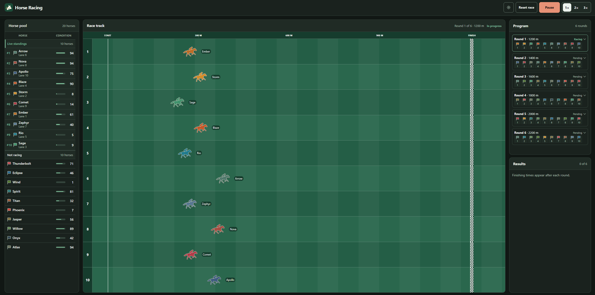

# Horse Racing — Insider One Case Study

[](https://github.com/eakarr/insider-one-test-case/actions/workflows/ci.yml)

A responsive horse-racing simulation built with Vue 3, TypeScript and Pinia for the Insider One frontend developer case study. Generate a race program, watch its six rounds unfold, and follow the standings and results in real time.

## Preview



## Features

- 20 horses with unique identities and colors, and randomly generated conditions from 1 to 100.
- Six rounds (1200, 1400, 1600, 1800, 2000 and 2200 m), each with 10 distinct horses.
- Automatic countdowns, round transitions, animated horses, live standings and final results.
- Pause, resume, reset and replay a race day; choose 1×, 2× or 3× playback.
- Responsive dashboard, light/dark themes, keyboard controls, live announcements and reduced-motion support.
- Deterministic simulation logic, automated unit/component tests and cross-browser E2E tests.

## Getting started

Requires Node.js 24 and Yarn Classic (1.22.x). If Yarn is not installed, run `npm install --global yarn@1`.

```sh
yarn install --frozen-lockfile
yarn dev
```

Open the local URL printed by Vite. To preview the production build, run `yarn build` followed by `yarn preview`.

### How to play

1. Select **Generate program** to draw the six round lineups.
2. Select **Start race**. Each round begins with a three-second countdown and advances automatically.
3. Use **Pause / Resume** or change playback speed at any time. Select **Reset race** and confirm to discard the unfinished program and results.
4. Inspect the program and results panels. After the final round, **Race again** returns to program generation.

Reset and Race Again retain the horse pool, theme and selected speed. Playback speed changes animation and running time, not simulated finish times or rankings.

## Tech stack

| Area              | Tools                                           |
| ----------------- | ----------------------------------------------- |
| UI                | Vue 3 Composition API, TypeScript, SCSS         |
| State             | Pinia                                           |
| Build and quality | Vite, Yarn, ESLint, Prettier, Husky, Commitlint |
| Testing           | Vitest, Vue Test Utils, jsdom, Playwright       |
| CI                | GitHub Actions                                  |

## Architecture

The application uses a small layered modular monolith. Vue components render the dashboard, composables handle timing and presentation, the Pinia store manages the lifecycle, and framework-independent domain functions generate and simulate races.

```text
src/
├── assets/
├── components/      # Shared and feature components
├── composables/     # Clock, presentation, theme
├── constants/
├── domain/          # Pure race calculations
├── helpers/         # Seeded randomness
├── models/
├── stores/
├── styles/
├── app.vue
└── bootstrap.ts
e2e/                 # Browser tests
```

See [Architecture](docs/architecture.md) and [Race simulation](docs/race-engine.md) for the design decisions and timing model.

## Quality checks

| Command              | Purpose                                |
| -------------------- | -------------------------------------- |
| `yarn lint`          | ESLint                                 |
| `yarn format:check`  | Prettier                               |
| `yarn typecheck`     | TypeScript and Vue type checking       |
| `yarn build`         | Production build                       |
| `yarn test`          | Unit and component tests               |
| `yarn test:watch`    | Vitest watch mode                      |
| `yarn test:coverage` | V8 coverage with regression thresholds |
| `yarn test:e2e`      | Playwright browser tests               |
| `yarn test:e2e:ui`   | Interactive Playwright runner          |

Install the browser binaries before the first E2E run:

```sh
yarn playwright install chromium firefox webkit
```

GitHub Actions runs quality checks and browser tests in separate jobs. HTML coverage is uploaded as an artifact; screenshots and traces are retained on browser failures. See [Testing and validation](docs/testing.md) for details and limits.

## Deployment

Run `yarn build` and deploy `dist/` to a static host. No API server, credentials or environment variables are required. For a repository subpath deployment, configure Vite's base URL for that path before building.

## Notes

- Earlier development builds had a Vue DevTools storage limitation. Recheck restricted-storage behavior after dependency changes.
- Automated browser and ARIA checks do not establish full accessibility compliance or real-device Safari compatibility.

## Git conventions

Branches use `<type>/<verb>-<description>`. Commits follow Conventional Commits with lowercase imperative subjects, no trailing period and a maximum header length of 100 characters.

## Author

Emir Akar

## License

UNLICENSED. No open-source license has been granted for this case study. Third-party assets remain subject to their respective rights.
