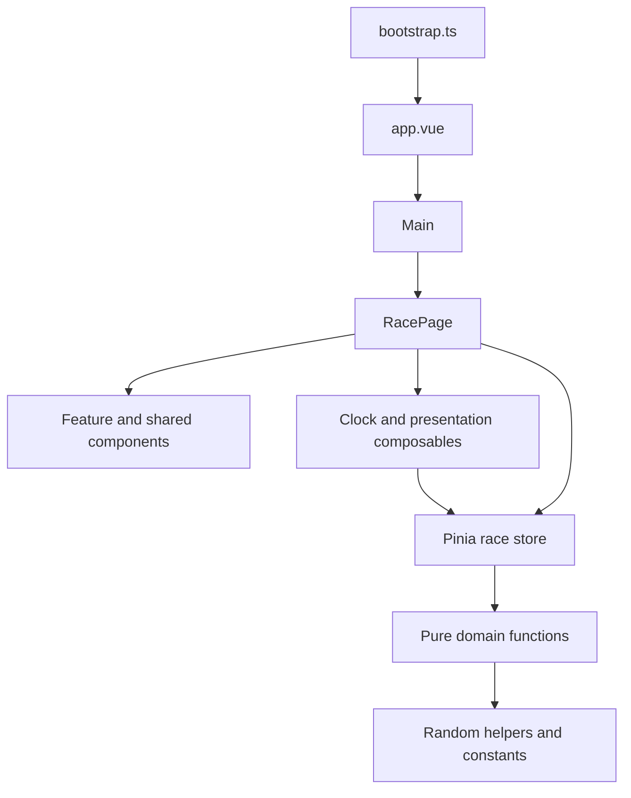

# Architecture

The application is a client-side layered modular monolith. No router, backend, service layer or external state synchronization is needed for a single-screen simulation.

## Entry point and responsibilities

Bootstrap mounts Vue and registers Pinia. App and Main provide the application entry hierarchy; RacePage composes the dashboard and connects user events to store actions. Components receive typed props and emit events. The store owns the lifecycle and prepared simulation profiles; the clock owns frame scheduling. Presentation maps domain state to lane, program, standings and results view models.

## Design decisions

- The domain layer has no Vue or DOM dependencies, so scheduling and simulation can be tested with deterministic inputs.
- A single RAF loop drives the simulation. Components render progress through CSS transforms; no horse has an independent timer.
- Computed presentation data separates stable round information from frame updates and preserves standings references when order is unchanged.
- Feature components own their scoped BEM styles; global theme tokens and breakpoints are shared SCSS partials.
- Unit and component tests are co-located in `__tests__/`; browser journeys live in `e2e/`.

The dashboard uses a stacked mobile layout and a three-column desktop layout at 1200px. Mobile standings move close to the track; larger layouts expose standings through the horse pool. Theme resolution occurs before first paint with a system-preference fallback.
