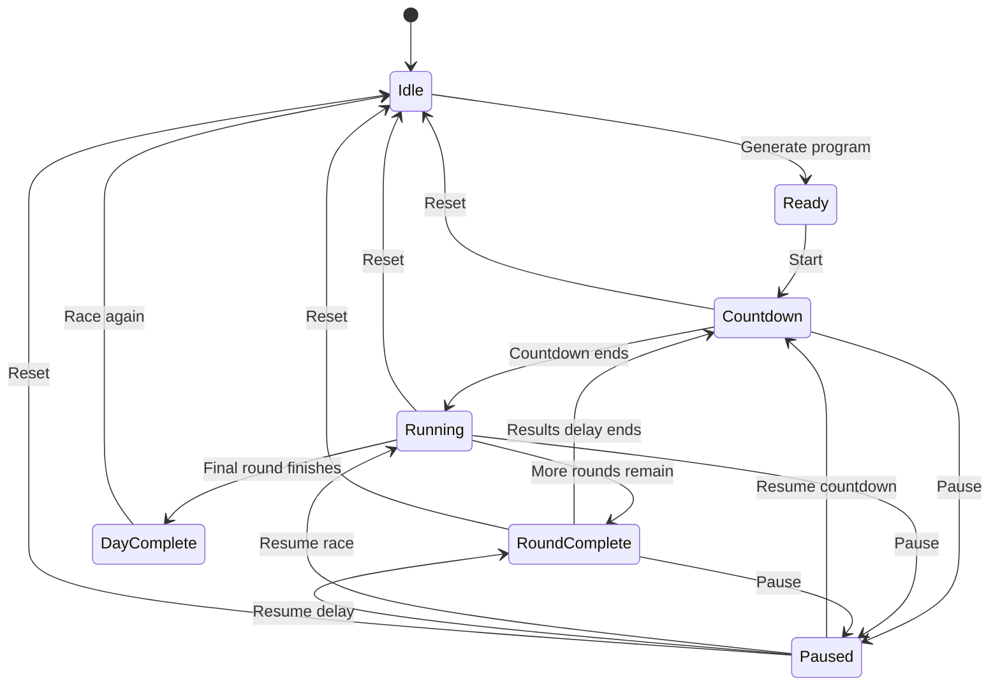

# Race simulation

## Program generation

The pool contains 20 predefined identities and distinct colors. A seeded PCG32 random source generates conditions in the inclusive range 1–100. Each of the six rounds draws 10 distinct horses from the pool. Horses may appear in more than one round.

The store uses separate seeded streams for conditions, program selection and performance variation. Identical seeds and action sequences produce identical simulations.

## Speed and results

Each round is prepared before racing. A horse's base simulated speed is adjusted by its condition and a seeded round multiplier. Three equal-distance segments introduce additional seeded speed variation, allowing overtaking. The configured baseline is 190 simulation meters per second, intentionally accelerated for an interactive demo.

The engine calculates cumulative segment times and derives distance from elapsed simulation time. Progress is clamped to the finish; finish times come from the prepared profile rather than frame arrival time. Ranking uses completed finish times first, then progress for unfinished horses, with lane order as a deterministic tie-breaker.

## Lifecycle

The race clock caps a frame delta at 100 ms. It multiplies running deltas by playback speed, but leaves the three-second countdown and 1.5-second inter-round delay unchanged. Phase-boundary overshoot is discarded. Pausing, hiding the document or resetting stops scheduling and clears the timestamp baseline; generation tokens and state identity guard against stale callbacks.

Reset clears the prepared profiles, program and results, retains the horse pool and selected playback speed, and returns to idle. Cancelling the native confirmation restores the interrupted phase without accumulating dialog time. Generating a new program consumes the next draws from the existing random streams rather than replaying the previous program.
